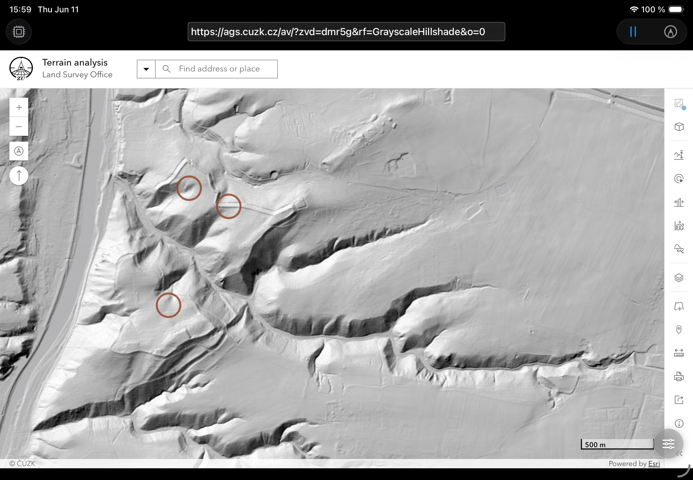

# ML Browser

ML Browser is an iOS app that combines a web browser with on-device machine learning: the user loads an object-detection or image-classification model — Core ML directly, or ONNX converted on the device itself — and Vision runs it against snapshots of the rendered page on a configurable timer, drawing the detections directly over the web content. No images leave the device.

The flagship use case — and where the name comes from — is archeology: browsing LIDAR / terrain-map sites with the bundled demo models to spot features such as burial mounds. But the app is model-agnostic; any imported detection model works the same way on any web content.

<p align="center">
  
</p>

## Repository layout

| Path | Contents |
|-|-|
| `ios/` | The Xcode workspace (`MLBrowser.xcworkspace`), app sources, unit/UI/architecture tests, test plans, and Xcode Cloud `ci_scripts/` |
| `Package.swift`, `Sources/NativeModelConverter/` | `NativeModelConverter` Swift package: a native `.aiagraph` → Core ML converter used by the iOS app. |
| `Tools/` | `ProjectTool` — a SwiftPM CLI for repo setup, pinned-tool installation, and secrets management |
| `scripts/` | Developer scripts: lint, codegen, architectural tests, unit tests |
| `cloudflare/` | Cloudflare Worker relaying Sentry issues into GitHub Issues ([details](cloudflare/README.md)) |
| `.github/workflows/` | CI: SwiftLint, Harmonize (architecture tests), issue-key automation |
| `.githooks/` | Git hooks (SwiftLint pre-commit, catalog-stability pre-push), enabled by `ProjectTool setup` |
| `.tools.json` | Pinned versions of swiftlint / swiftgen / sentry-cli used by all developers and CI |

## Supported model formats

Core ML models load directly. ONNX models are converted **on the device** by the bundled
`NativeModelConverter` — no Python, no server, no `coremltools`. Import from Files, or paste a URL
into the importer's **Download from URL** field.

| Format | Task | Handling |
|-|-|-|
| `.mlmodel`, `.mlpackage`, `.mlmodelc` | Detection, classification | Loaded directly |
| `.onnx` | Image classification | Converted on-device. When the output width matches ImageNet-1k, the ImageNet labels and RGB normalization are applied and the model runs as a Core ML classifier |
| `.onnx` | Object detection — raw-grid YOLOv2-family heads | Converted on-device into a Core ML *pipeline* model (single file): the converted network plus a synthesized box decode, followed by Core ML's built-in non-maximum suppression. Vision then returns standard `VNRecognizedObjectObservation`s |
| `.onnx` | Object detection — anchor-free YOLOv8 / YOLO11 raw exports (`nms=False`, `[1, 4 + classes, N]`) | Structurally recognized and converted into a Core ML detector pipeline; labels use source metadata when present. This includes YOLO11's attention-based export graph. |
| `.onnx` | YOLOv5 raw trunk (`[1, N, 5 + classes]`) | Converted and numerically checked as a plain Core ML network, including the rank-5 tensor operations used by the pinned export. It is **not** an app-ready detector: YOLOv5 box decode, objectness × class scoring, and NMS have not yet been implemented. |
| `.onnx` | Detection with embedded post-processing (`NonMaxSuppression`, `Loop`, dynamic shapes) — SSD, tiny-yolov3, ssd-mobilenet | Rejected with a precise diagnostic naming the unsupported operator |
| `.aiagraph` | — | Internal interchange package (versioned, SHA-256 pinned); not a format users are expected to author |
| `.tflite` | — | Not supported yet |

**Attribution travels with the conversion.** A converted `.onnx` model carries the source model's
description, author, version and license (from `doc_string` / `metadata_props`) in its Core ML
metadata, mirrors every other metadata key the author wrote under
`com.aiarcheology.native.source.user-defined.*`, records the original filename, and states in its
description that it is a conversion — so exporting a converted model never strips the original
work's identity or license terms. Fields the source file does not carry stay empty rather than
being invented.

A converted detector is **one `.mlmodel` file**, exactly like a converted classifier. "Pipeline"
describes its internal structure — Apple's own detector exports (Create ML, Turi Create,
coremltools) and this repo's bundled demo detectors have the same two-stage shape — because a static
neural network cannot express suppression, whose output row count depends on the input.

### Conversion parity evidence

Each model below converts on-device and reproduces the predictions of an independent
**onnxruntime** oracle; see [NATIVE_MODEL_CONVERSION.md](specification/NATIVE_MODEL_CONVERSION.md) and
`Tests/NativeModelConverterTests/Fixtures/ONNXConversionModels.json`.

| Model | Task | Asserted against the oracle |
|-|-|-|
| MobileNetV2 | Classification | Top-1 label per probe |
| ResNet-50 | Classification | Top-1 label per probe |
| SqueezeNet 1.0 | Classification | Top-1 label and probability |
| Tiny YOLOv2 (Pascal VOC) | Detection | Box count, IoU ≥ 0.9 per box, class label, confidence |
| YOLOv8n (raw export, 640×640) | Detection trunk | Raw `[1, 84, 8400]` output at 507 sampled positions, abs tolerance 0.002 |
| YOLO11n (raw export, 640×640) | Detector | Raw `[1, 84, 8400]` output at 14 sampled positions; detector-pipeline class count and source-metadata label provenance |
| YOLOv5-L custom (raw export, 640×640) | Conversion trunk only | Raw `[1, 25200, 6]` output at 20 sampled positions; not an app detector |

### ONNX operator coverage

| Operator | Accepted forms |
|-|-|
| `Conv` | Including `auto_pad` SAME_UPPER/VALID and asymmetric padding |
| `BatchNormalization`, `Gemm` | `Gemm` requires the standard `y = xWᵀ + b` form (`transB=1`, unit alpha/beta) |
| `Relu`, `LeakyRelu`, `Sigmoid`, `Clip` | `Clip` maps to ReLU6 only at exactly `[0, 6]` |
| `Add`, `Mul`, `Sub`, `Div` | Same-shape activations, or a constant operand — scalar, per-channel, or a spatial table expanded statically. `Sub` lowers to an add (Core ML has no subtract); `Div` accepts a constant divisor only, as a multiply by its reciprocal |
| `MaxPool`, `GlobalAveragePool` | Dense, non-dilated pooling |
| `Concat` | V1: channel axis at rank 3–4; V2: static tensors of any rank on a shared, explicit axis |
| `Slice` | V1: single-axis **channel** slices. V2: static, unit-stride slices on any distinct tensor axes |
| `Split` | Static input or attribute sizes. V1 channel splits lower to slices; V2 preserves multi-output splits on any axis |
| `MatMul` | V2 batched matrix multiplication for rank-2-or-higher static tensors, including NumPy-style batch broadcasting |
| `Pow` | V2 constant exponent `2` only, lowered exactly to `Mul(x, x)` |
| `Reshape`, `Flatten` | Static targets with `-1` inferred. V2 preserves arbitrary static rank; a `[batch, features]` collapse stays a flatten so classifier interfaces are preserved |
| `Transpose` | Explicit `perm`. V1 accepts rank 3–4; V2 preserves an explicit permutation of any static rank (the reverse-all-axes default is rejected) |
| `Resize` | Nearest + `asymmetric` + `floor` + integer scale factors only — the one configuration Core ML's upsample reproduces exactly |
| `Softmax` | Opset-aware axis semantics. V2 supports any explicit axis, including `axis=-1`; V1 uses the legacy rank-5 channel layout |
| `Dropout`, `Identity`, `Shape`, `Constant`, `ConstantOfShape` | Folded away |

Anything outside this set is rejected rather than approximated: a model that converts is expected to
match its source, and one that cannot is expected to say why. The restrictions above are enforced,
not documented aspirationally — e.g. a `half_pixel` `Resize` or a two-activation `Div` fails with a
diagnostic instead of converting to something that merely compiles.

## NativeModelConverter Swift package

`NativeModelConverter` is a local Swift Package Manager dependency for ML Browser. It reads a
standard `.onnx` file, or a versioned `.aiagraph` directory, and emits a Core ML `.mlmodel` entirely
in native Swift—no Python is bundled with, or invoked by, the iOS app. See
[Supported model formats](#supported-model-formats) for what converts today.

| Item | Value |
| --- | --- |
| Library product | `NativeModelConverter` |
| Supported platforms | iOS 17+, macOS 14+ |
| App use | An `.onnx` or `.aiagraph` import journals a path-free conversion report, validates/writes `converted.mlmodel` off the main actor, then uses the existing Core ML loading path. Interrupted imports can resume or be explicitly discarded; a registered conversion can be explicitly exported as a metadata-preserving ZIP. |
| Development CLIs | `native-model-converter` converts one package; `native-model-evaluator` runs an emitted model through Core ML for terminal parity tests. |
| Format version | Native graph package v1 (legacy Core ML layout) and v2 (exact N-D tensor layout); graph, weights, and optional source metadata are SHA-256 pinned. Converted source metadata is retained as `converted.metadata.json`; the app retains a path-free `native-conversion-report.json` with lifecycle and support evidence. |
| Converter provenance | Source package filename, original filename/remote URL when known, source exporter name/version, graph format, Swift package SemVer, conversion revision, interface, and artifact hashes are embedded in the generated `.mlmodel`; version history remains traceable after the app converter evolves. |
| Client observability | `NativeModelConverter.convert` reports package/emission progress, process-memory samples, cancellation, stable diagnostics, artifact sizes, and monotonic timings; it also emits OSLog signposts for Instruments. A process-global FIFO gate runs one high-level conversion at a time and reports `waitingForExclusiveAccess` to queued jobs. |

### Apple platform scope

| Distribution / target | Support | Evidence and boundary |
| --- | --- | --- |
| iPhone and iPad | iOS 17+ | `Package.swift` declares `.iOS(.v17)`; this is the ML Browser app target. |
| Mac, Designed for iPad | iOS 17+ compatibility runtime | It runs the iOS app/package slice, so the iOS 17 deployment target applies. |
| Native macOS app | macOS 14+ | `Package.swift` declares `.macOS(.v14)`; terminal compile/evaluation tests run on this target. |
| watchOS, tvOS, visionOS, Mac Catalyst | Not supported/claimed yet | No platform declaration or test evidence exists in this package. |

The package is already registered in `ios/MLBrowser.xcodeproj` as a local package reference. To add
it to another target in Xcode, choose **File → Add Package Dependencies… → Add Local…**, select this
repository root, and add the `NativeModelConverter` library product to that target. `.onnx` files are
read directly by `ONNXModelReader`; other source formats must lower into the validated graph package
first.

The API guide is available in Xcode's documentation browser as **Native Model Converter**. The
format, supported operators, validation policy, test harness, and current parity evidence are
maintained in [NATIVE_MODEL_CONVERSION.md](specification/NATIVE_MODEL_CONVERSION.md).

## Prerequisites

- **macOS with Xcode** (the team currently builds with Xcode 26.x; an iPhone simulator runtime is required for tests)
- **Swift toolchain** (ships with Xcode) — needed to run `ProjectTool`
- *Maintainers only:* **1Password CLI** (`op`), signed in — the project vault holds the service
  keys. **Contributors do not need it**: see
  [Building without the project vault](#building-without-the-project-vault).
- *Optional:* **Homebrew** — only if you opt into [direnv command aliases](ios/MLBrowser/README.md#directory-aliases-via-direnv) during setup

## Getting started

```bash
git clone git@github.com:aiarcheology-com/aiarcheology.git
cd aiarcheology

# 1. Install pinned tools, configure git hooks (one-time)
swift run --package-path Tools ProjectTool setup

# 2. Provide ios/Secrets.xcconfig — the build will not start without it. Pick ONE:
#    (a) maintainers, with the project vault:
swift run --package-path Tools ProjectTool secrets generate
#    (b) everyone else: see "Building without the project vault" below.

# 3. Open the workspace and run the MLBrowser scheme
open ios/MLBrowser.xcworkspace
```

`ProjectTool setup` installs the pinned tools to `/usr/local/bin` **if that is writable**, and
otherwise creates and uses `~/.local/bin` — it does not fail on permissions. If it takes the second
path it prints a note, and you need `~/.local/bin` on your `PATH` or the later `./scripts/*.sh`
wrappers will not find `swiftlint`/`swiftgen`. **Do not run `ProjectTool` under `sudo`** to force
the system directory: it leaves root-owned build artefacts in `Tools/.build` that break every
later `swift run`.

The full setup reference — every `ProjectTool` command, pinned tooling, secrets lifecycle, and the optional shell aliases — lives in **[ios/MLBrowser/README.md](ios/MLBrowser/README.md)**.

## Building without the project vault

The app builds, runs, and passes its unit suite on the simulator with **no 1Password vault, no
accounts, and no production services**. This is the supported path for contributors, and the rest
of this section is the whole of it.

### 1. Create `ios/Secrets.xcconfig`

This file is not optional. It is the `baseConfigurationReference` for **both** the Debug and
Release configurations, so the build cannot start without it. It is gitignored, so your copy stays
yours.

Create it with every key present and empty:

```bash
cat > ios/Secrets.xcconfig <<'EOF'
// Local build configuration. No secrets. Gitignored.
SENTRY_DSN =
CLERK_PUBLISHABLE_KEY =
CLERK_PUBLISHABLE_KEY_LIVE =
CONFIGCAT_SDK_KEY =
CONFIGCAT_SDK_KEY_LIVE =
TELEMETRYDECK_APP_ID =
EOF
```

Two traps worth naming:

- **Do not copy `ios/Secrets.template.xcconfig` into place.** It holds `op://` vault *references*,
  not values. It will not even survive as a literal: `//` starts a comment in an xcconfig, so each
  reference is truncated and you get invalid build settings rather than an obvious error.
- If you ever do supply a real URL-shaped value, escape `://` as `:$()/$()/` — a bare `//` starts a
  comment in an xcconfig. `ios/ci_scripts/ci_pre_xcodebuild.sh` does exactly this when it generates
  the same file on CI.

`ProjectTool secrets refresh` regenerates this file *from the vault*. Without one it will fail
rather than help, and it would overwrite the file you just wrote — there is no reason to run it.

### 2. What degrades without keys

| Service | Behaviour with no key |
|-|-|
| **Clerk** (sign-in) | Debug builds use an in-memory mock and you are signed in automatically — `DependencyContainer.swift` `usesMockAuth` |
| **ConfigCat** (feature flags) | Falls back to the compiled defaults in `ios/MLBrowser/iOS/State/FeatureFlags.swift` |
| **Sentry** | Not initialised; no crash reporting |
| **TelemetryDeck** | Optional product analytics stay disabled |

Everything the app is actually for — browsing, importing a model, on-device detection, saving and
exporting findings — works untouched.

**This path is Debug and simulator only.** The auth mock is inside `#if DEBUG`, and a Release build
with no publishable key reaches an unconfigured `Clerk.shared` and traps. Do not try to archive
without keys.

### 3. Code signing

`project.pbxproj` commits `DEVELOPMENT_TEAM = ZLR4X4U8UQ`, and `ios/MLBrowser/MLBrowser.entitlements`
requests Sign in with Apple, associated domains, and the increased memory limit — capabilities a
free Apple ID cannot sign. For simulator work, override the team with your own rather than turning
signing off:

```bash
xcodebuild -workspace ios/MLBrowser.xcworkspace -scheme MLBrowser \
  -destination 'platform=iOS Simulator,name=iPhone 17' \
  DEVELOPMENT_TEAM=YOUR_TEAM_ID build
```

Do not pass `CODE_SIGNING_REQUIRED=NO` to get around it: the Keychain tests need the embedded
entitlements, so an unsigned simulator build fails them for an unrelated reason. See
[TESTING.md](specification/TESTING.md).

Running on a **physical device** additionally needs your own bundle identifier and the entitlements
trimmed to what your account can sign. That is not a supported contributor path today.

### 4. Demo models

Only the two first-party demo detectors (`AIArcheology` and `HroudaDetector15`) are committed
under `Drivers/Demo Models/`. Ordinary app builds need no Apple model download.

FastViT is an on-demand test fixture, cached in the gitignored `.apple-test-fixtures/` directory:

```bash
./scripts/fetch_apple_test_models.sh           # fetch missing/corrupt fixtures; verify pinned hashes
./scripts/fetch_apple_test_models.sh --verify  # verify the local cache without network access
```

The unit-test wrapper fetches it automatically. For direct Xcode unit/UI test runs, fetch first
and pass `AIA_INCLUDE_TEST_FIXTURES=YES`; see [TESTING.md](specification/TESTING.md).
Only opted-in Debug builds embed the fixture. Ordinary builds omit it, and Release builds reject
fixture opt-in. UI tests seed it only on explicit launch configuration; normal app launches never do.

The first-party demos are Apache-2.0. Apple's separate fixture terms and notices are in
[the fixture licence guide](ios/TestFixtures/FastViT/LICENSE.md).

## Day-to-day commands

| Command | Purpose |
|-|-|
| `./scripts/swiftlint.sh` (`fix` to autocorrect) | SwiftLint over the iOS sources |
| `./scripts/harmonize.sh` | Architectural rules, enforced as tests |
| `./scripts/unittest.sh` | Unit test plan on a simulator |
| `./scripts/aia-xcode-cloud-poll.sh --branch develop --watch` | Observe the latest branch build; [build URLs, credentials and options](specification/TESTING.md#observe-xcode-cloud) |
| `./scripts/swiftgen.sh generate` | Regenerate `L10n.swift` after editing `Localizable.xcstrings` |

Run lint + harmonize + unit tests before pushing; the same checks gate pull requests in CI (GitHub Actions for lint/architecture, Xcode Cloud for analyze/archive/unit tests).

## 🚀 Emergency delivery lane (Xcode Cloud fallback)

When Xcode Cloud is unavailable (allocation exhausted, outage), `scripts/deliver.sh` archives the app
locally and uploads it to TestFlight. Prefer Xcode Cloud for routine releases — this is a break-glass lane.

**Prerequisites**

- An **App Store Connect API key** with a role that can manage builds (**App Manager**, or a Developer
  role scoped to this app) — a weaker role returns `403` on upload/notes. Create it under
  App Store Connect → Users and Access → Integrations → App Store Connect API, download the
  `AuthKey_XXXX.p8` **once**, and keep it out of the repo (`*.p8` is gitignored).
- A valid **Apple Distribution** signing identity + provisioning in your login keychain (automatic
  signing; the archive uses `-allowProvisioningUpdates`, which may register devices/profiles in the
  Developer Portal).
- 1Password CLI (`op`) if you store the key there; otherwise a local `.p8` path.

**Credentials** — an App Store Connect API key. This is a *delivery* credential: a private,
account-level key that can upload builds, read sales data and manage users. It is deliberately
**not** part of `Secrets.xcconfig` (which compiles build secrets into the app) and must never
become an input to the app build.

The recommended setup is to materialize it **once** from 1Password:

```sh
swift run --package-path Tools ProjectTool asc credentials generate
```

That resolves the `op://` references in `ios/asc.env` into the gitignored `ios/asc.auth/`
(directory `0700`; `AuthKey_<KEYID>.p8`, `key-id` and `issuer-id` each `0600`). `deliver.sh` reads
those files directly, so a delivery no longer depends on a live 1Password session at an arbitrary
moment during a long run — a session that expired mid-sweep used to discard ten minutes of work.

| Command | Effect |
|-|-|
| `asc credentials generate` | Resolve from 1Password if not already present |
| `asc credentials refresh` | Re-resolve, replacing the directory (use after key rotation) |
| `asc credentials status` | Report the materialized key id (never prints key material) |
| `asc credentials clean` | Remove the directory and the private key it holds |

Without `ios/asc.auth/`, `deliver.sh` still falls back to resolving the `op://` references on every
run, writing the key to a short-lived `0600` temp file wiped on exit. Explicit `ASC_*` environment
variables always win over both — `ASC_KEY_PATH` points at a `.p8` already on disk (keep it outside
the repo, `chmod 600`).

The simplest setup is a gitignored `ios/asc.env` that `deliver.sh` sources automatically — copy the
template, then edit the vault/item/key-id to match your 1Password:

```sh
cp ios/asc.env.template ios/asc.env
```

```sh
# ios/asc.env — 1Password references (not secrets); resolved with `op` unlocked.
export ASC_KEY_ID='op://Personal/App Store Connect API Key/key id'
export ASC_ISSUER_ID='op://Personal/App Store Connect API Key/issuer id'
export ASC_KEY_OP_REF='op://Personal/App Store Connect API Key/AuthKey_XXXXXXXXXX.p8'
```

Or export them yourself (explicit env vars always win over `ios/asc.env`); `ASC_KEY_PATH` points at a
local `.p8` instead of 1Password if you prefer. Store the key with the **App Manager** role.

**Usage**

This is **Plan B** for the Xcode Cloud **"Release"** workflow, which archives + distributes from
`release/*` branches. The local lane keys off the same branches, so releasing is identical either way:

Cut the release branch from `develop`. Pushing it triggers paid Xcode Cloud work. To promote the
reviewed state to `main`, open a PR with that disposable `release/*` branch as the source and
`main` as the target. Never use `develop` as a PR source: automatic head-branch deletion can remove
it when an administrator bypasses deletion protection. Keep automatic branch deletion enabled
so merged feature and release branches are cleaned up.

```sh
# 0. Cut the release branch from develop (the same trigger the Xcode Cloud Release workflow uses).
git checkout develop && git pull
git checkout -b release/<tag_description>

# 1. Always rehearse first — fully offline: no network, no 1Password read, no JWT.
./scripts/deliver.sh deliver --dry-run --build-number <n>

# 2. (Optional) Validate the archive against App Store Connect WITHOUT uploading — like Xcode's
#    "Validate App". `deliver` also does this automatically right before uploading.
./scripts/deliver.sh validate

# 3. Archive → validate → upload to TestFlight (build number auto-resolves to App Store Connect max + 1).
./scripts/deliver.sh deliver

# 4. After the build finishes processing, push the tester notes from ios/TestFlight/WhatToTest.en-US.txt.
./scripts/deliver.sh notes --build-number <n>        # <n> is echoed by step 3

# Offline crypto + redaction self-tests (no credentials needed):
./scripts/deliver.sh selftest
```

**Notes**

- **Release branch required:** `deliver` / `validate` refuse to run unless you're on a `release/*`
  branch (mirroring the Xcode Cloud Release workflow) or you pass an explicit `--ref <tag|sha>` that
  matches `HEAD`. This keeps the local lane shipping the same commits Xcode Cloud would.
- **Pre-upload validation:** `deliver` validates the archive against App Store Connect (icons,
  entitlements, Info.plist keys, provisioning, architectures) *before* uploading — the CLI equivalent
  of Xcode Organizer's "Validate App" — and aborts on failure. `--skip-validate` bypasses it; the
  standalone `validate` subcommand runs the check without uploading. Validation uses `xcrun altool`
  (deprecated but the only CLI that validates pre-upload); the upload itself uses `xcodebuild` and is
  independent of it, so `--skip-validate` keeps you shipping if `altool` is ever removed.
- `--build-number` selection (`max + 1`) is **not atomic**. `deliver` re-checks the number against
  App Store Connect right before uploading (and aborts if it was taken meanwhile), which shrinks but
  does not eliminate the race — two operators archiving simultaneously can still collide. For a
  guaranteed-unique number, coordinate out of band and pass an explicit `--build-number`. (A shared
  atomic reservation is intentionally out of scope for this single-operator break-glass lane.)
- `--export-only` writes a signed `.ipa` under `build/delivery/export/` instead of uploading; upload it
  manually with `xcrun altool --upload-app -f <ipa> --apiKey <id> --apiIssuer <issuer>` (key in
  `~/.appstoreconnect/private_keys/`).
- Outputs land under `build/delivery/` (gitignored). dSYMs are uploaded to **Sentry** by the archive's
  own "Upload Debug Symbols to Sentry" build phase (during archiving) and to **App Store Connect** by
  the export step (`uploadSymbols=true` in `ExportOptions.plist`); the script adds no separate dSYM
  upload of its own.
- The live archive/upload/notes paths are **exercised by the operator** — validate the script logic
  first with `deliver --dry-run` and `selftest`.

## Feature flags & observability

Three different tools answer three different questions. Mixing them up is the most common
mistake here:

| Tool | Answers | Status |
|-|-|-|
| **ConfigCat** | *Should this feature be on?* — remote feature flags, flippable without an App Store release | **live** — see [FEATUREFLAGS.md](specification/FEATUREFLAGS.md) |
| **Sentry** | *Did something break?* — crashes, errors, diagnostics | live — see [LOGGING_GUIDE.md](specification/LOGGING_GUIDE.md) |
| **TelemetryDeck** | *Is the feature used?* — product analytics (DAU/MAU, retention, funnels) | **implemented in the client**, and inert until both the ConfigCat feature and the user's own opt-in allow it; policy and release review still outstanding — see [ANALYTICS.md](specification/ANALYTICS.md) |

Sentry is **not** product analytics and does not overlap TelemetryDeck. Neither measures
battery or performance attribution — that's Xcode Organizer / MetricKit / Sentry profiling.

**Feature flags in one minute.** `FeatureFlagKey` (in
`ios/MLBrowser/iOS/State/FeatureFlags.swift`) holds each flag's ConfigCat key and its
compiled default. Values resolve through a ConfigCat adapter and are published by
`FeatureFlagsState`. Two things to internalise before touching them:

- **They fail open.** Defaults are `true`, so offline / bad key / outage leaves a "killed"
  feature **on**. This is not a guaranteed remote kill switch.
- **Not every flag may apply live.** `isPaymentsEnabled` is captured once at launch, because
  `SubscriptionGateView` is the app root — a mid-session flip would drop a paywall on a user
  who is mid-detection. `isModelCatalogEnabled` applies live.

Keys live in 1Password (`ConfigCat Keys`); Debug builds use the ConfigCat **Test**
environment, Release uses **Production**. Tests and previews never touch the network.

## Conventions

- **Branches**: branch normal work from `develop` as `<type>/AIA-XXXX/description`, with `feature`, `fix`, `doc`, or `test`, and target `develop` with its PRs. Release promotion uses a disposable `release/*` branch cut from `develop`, with a PR into `main`. Never use `develop` as a PR source or commit directly to `develop` or `main`. See [AGENTS.md](AGENTS.md#issues-and-git) for the repository workflow.
- **Commits**: imperative summary prefixed with the issue key — `[AIA-XXXX] Fix crash when…`.
- **Issues**: GitHub Issues carry `AIA-####` keys (normalized automatically by the `auto-issue-key` workflow); production crashes arrive as issues via Sentry → Cloudflare relay.

### Release baseline

**In production: app `1.0.8`, Core Data model `0.0.2`.**

Keep both figures current — they are what tells you whether a migration is required, whether a
stored format may still change freely, and which build a bug report is actually about. Updating
them is part of shipping a release; see [AGENTS.md](AGENTS.md#review-and-delivery).

**Three source models are now live at once**, because `1.0.6` shipped `0.0.0`, `1.0.7` shipped
`0.0.1`, and `1.0.8` shipped `0.0.2` — and a user may update from any of them straight to the next
release without installing the ones in between.

| State | Model version | Migration rule |
|-|-|-|
| Live release | `0.0.2` (`MLBrowser_0.0.2.xcdatamodel`) | Shipped in `1.0.8`. **Frozen — never edit in place.** |
| Still in the field | `0.0.1` (`MLBrowser_0.0.1.xcdatamodel`) | Shipped in `1.0.7`. Frozen. |
| Still in the field | `0.0.0` (`MLBrowser.xcdatamodel`) | Shipped in `1.0.6`. Frozen. |
| Development target | *none — the next schema change creates `0.0.3`* | `0.0.2` shipped, so it is no longer a free-to-edit destination. |
| Required **today** | `0.0.0 → 0.0.2` **and** `0.0.1 → 0.0.2` | The paths 1.0.8 ships. They must keep working. |
| Required **once `0.0.3` exists** | `0.0.0 → 0.0.3`, `0.0.1 → 0.0.3` **and** `0.0.2 → 0.0.3` | One mapping model per live source, each covered by its own `FindingMigrationTests` case. |

**Migration is single-hop — this is the part that is easy to get wrong.** Core Data matches *one*
mapping model to the (store's version hashes, current model) pair; it never chains through
intermediate versions. Shipping `0.0.0 → 0.0.1` and `0.0.1 → 0.0.2` in the same binary does **not**
produce a `0.0.0 → 0.0.2` path — measured on AIA-0651 by removing the direct mapping from the build,
at which point a `0.0.0` store fails to open with both of the others present. So **every new model
version needs a mapping from every source model still in the field**, not just from its predecessor.
Chaining would require adopting `NSStagedMigrationManager` (iOS 17+), which this app does not use.

A missing mapping is not a silent reset: App Store builds disable inference *and* are excluded from
the destroy-and-recreate recovery, so it is a `criticalFailure` at launch. The current Debug app
configuration also disables inference; TestFlight and the `DataController(storeURL:)` test helper
can infer mappings. A successful launch is therefore insufficient evidence. `FindingMigrationTests`
explicitly disables inference and bypasses the controller's recovery path to verify each shipped source.

**Shipped model versions are immutable.** Evolving one requires a new version. An unreleased
destination without mappings may be edited in place. Once mappings exist, treat the destination
and its mapping artifacts as one unit: each `.xcmappingmodel` embeds an archived destination model.
An intentional edit to an unreleased destination requires regenerating every affected mapping
with Xcode and running inference-disabled migration tests from every supported shipped source.
Until a schema change introduces `0.0.3`, the two shipped paths above are what must be preserved
and verified; the moment it does, that becomes three. A successful inferred migration in a test
helper or TestFlight does not establish App Store compatibility.

## Licence

The **source code** in this repository is licensed under the Apache License, Version 2.0 — see
[LICENSE](LICENSE).

That grant does **not** extend to everything in the tree. Apache-2.0 section 4(d) is explicit that
a `NOTICE` file cannot modify the licence, so the carve-outs are stated here, and the excluded
paths are named:

| Not covered by LICENSE | Terms |
|-|-|
| `.apple-test-fixtures/FastViTT8F16.mlpackage` (downloaded) | Apple's, from the Core ML model gallery. Test fixture only, not an app demo; excluded from Release builds. Apple's custom licence permits redistribution subject to its notice requirements; see the [model licence](ios/TestFixtures/FastViT/LICENSE.md). |
| `ios/TestFixtures/FastViT/FastViT-LICENSE.txt`, `FastViT-ACKNOWLEDGEMENTS.txt` in that directory | Verbatim Apple and component notices, retained under their original terms; see the [fixture licence guide](ios/TestFixtures/FastViT/LICENSE.md). |
| `Tests/NativeModelConverterTests/Fixtures/ADAF/*` | CC-BY-SA-4.0 — ShareAlike. [Attribution](Tests/NativeModelConverterTests/Fixtures/ADAF/NOTICE.md) |
| `ios/MLBrowserUnitTests/Fixtures/MapHarness/*.js` | Leaflet and OpenLayers, BSD-2-Clause |
| `ios/MLBrowser/iOS/Assets/Assets.xcassets/AppIcon.appiconset/*.png`, `ios/MLBrowser/iOS/Assets/Assets.xcassets/AppLogo.imageset/AppLogo.png` | App icon and logo artwork; no separate reuse licence is granted. See the [brand policy](specification/BRAND_POLICY.md). Asset-catalog configuration files are not artwork. |
| `ios/MLBrowser/iOS/Assets/Assets.xcassets/WelcomeBackground.imageset/*`, `ExampleScreenshot.jpg` | Ownership confirmed by the repository owner on 2026-09-14 in #906. These remain excluded from the source-code grant; no separate reuse licence is recorded. See [NOTICE](NOTICE), section 5. |

**The detection models are included in the grant.** `AIArcheology.mlpackage` and
`HroudaDetector15.mlpackage` are first-party weights — trained by this project on its own data, from
scratch rather than fine-tuned from the CC-BY-SA-4.0 ADAF checkpoints — so they carry the same
Apache-2.0 licence as the code. For a repository whose point is on-device detection, weights under a different licence to the
code would be the asterisk that mattered, so it is stated rather than left to be inferred.

[NOTICE](NOTICE) is the attribution record for the assets above. The
[brand policy](specification/BRAND_POLICY.md) explains use of the AI Archeology and ML Browser
names, the logo and app icon, the official App Store identity, and branding for independent
forks. It preserves factual attribution and the Apache-2.0 rights in the code and first-party
models; it does not grant reuse rights for excluded artwork or assert trademark registration.

The 22 former gallery photographs came from Apple's Image Gallery sample. The owner chose
removal, and the corrected `main` and `develop` histories contain none of those photo blobs or
paths. On 2026-09-17, tags `1.0.7` / `1.0.8` were repointed to their corresponding cleaned release
commits, preserving tag annotations and release contents apart from the photos and their Xcode
resource entries. The temporary `main-public` / `develop-public` branches and the old backup
branches `main-old` / `develop-old` were deleted after recovery verification on the same date.
**Repository-wide cleanup remains incomplete:** historical PR references and other GitHub copies
still need cleanup. See [NOTICE](NOTICE), section 5, and
[#906, A2](https://github.com/aiarcheology-com/aiarcheology/issues/906) for the remaining publication
work. Removal does not grant rights to historical copies.

Contributing: [CONTRIBUTING.md](.github/CONTRIBUTING.md) ·
[Code of Conduct](.github/CODE_OF_CONDUCT.md) · [Security policy](.github/SECURITY.md).

## Further reading

| Document | What it covers |
|-|-|
| [.github/CONTRIBUTING.md](.github/CONTRIBUTING.md) | How to propose a change: issues, branches, commits, the local gates, and what makes a reviewable PR |
| [LICENSE](LICENSE) · [NOTICE](NOTICE) | Apache-2.0 for the source code, and the per-asset attribution record for everything it does not cover |
| [AGENTS.md](AGENTS.md) | Repository-wide scope, privacy, verification, Git, review, and delivery rules. **Read before contributing** |
| [ios/AGENTS.md](ios/AGENTS.md) | Additional app rules: architecture/state, concurrency, persistence, localization, and ownership |
| [TESTING.md](specification/TESTING.md) | Current suites, relevant-test selection, commands, fixture gates, and trustworthy results |
| [ios/ARCHITECTURE.md](ios/ARCHITECTURE.md) | Codebase map: layering, composition root, app entry & gating, the detection pipeline, persistence |
| [ios/MLBrowser/README.md](ios/MLBrowser/README.md) | Project setup, `ProjectTool` reference, pinned tools, secrets via 1Password, Xcode Cloud notes |
| [FEATUREFLAGS.md](specification/FEATUREFLAGS.md) | Remote feature flags (ConfigCat): the current flags, live vs launch-only application, fail-open limits, environments, and how to add a flag |
| [ANALYTICS.md](specification/ANALYTICS.md) | Product analytics (TelemetryDeck) — **implemented in the client, not yet enabled for release**: event set, the notice-before-gates requirement, and what is/isn't collected |
| [RATING.md](specification/RATING.md) | The native App Store rating prompt: which moments trigger it, the request policy, where it never appears (TestFlight included), and how to test it by hand |
| [LOGGING_GUIDE.md](specification/LOGGING_GUIDE.md) | OSLog categories, log levels, privacy annotations, Sentry breadcrumb/quota policy |
| [cloudflare/README.md](cloudflare/README.md) | Sentry → GitHub Issues relay worker: architecture, setup, configuration |
