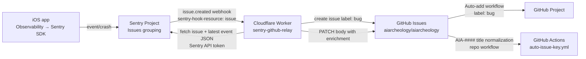

# Sentry → Cloudflare Worker → GitHub Issues (+ Project) Relay

This folder contains the Cloudflare Worker that turns **Sentry Issue webhooks** into **GitHub Issues**, plus optional **Sentry API enrichment** (issue + event JSON) stored in the GitHub issue body.

- Worker source: `cloudflare/sentry-github-relay-worker.js`

## Architecture (high level)

## What this pipeline does

- **Event-driven**: no polling / no scheduled GitHub Actions to fetch Sentry.
- **Dedupe**: one GitHub issue per Sentry issue group (uses a stable marker in the GitHub issue body).
- **Readable titles**: strips a leading `ISO_TIMESTAMP File.swift:line` prefix from Sentry titles (when present) and moves those details into the body.
- **Richer context**: fetches additional structured data via Sentry REST API and stores a redacted + size-capped JSON snapshot in the GitHub issue body.
- **Project automation**: GitHub Project can auto-add new issues by label.

## 1) Cloudflare Worker setup

1. Create a Cloudflare Worker (start with “Hello World”).
2. Copy/paste the code from `cloudflare/sentry-github-relay-worker.js` into the Worker editor.
3. Deploy.

### Worker URL

Your Sentry webhook URL should point to:

- `https://<worker>.<subdomain>.workers.dev/sentry/webhook`

## 2) Sentry: create an Internal Integration (Custom Integration)

In Sentry:

1. Go to **Settings → Developer Settings → Custom Integrations**
2. Create an **Internal Integration**
3. Set:
   - **Name**: `GitHub Issue Relay` (any)
   - **Webhook URL**: your Worker URL (example above)
   - **Alert Rule Action**: optional (not required for issue webhooks; useful for separate notifications)
4. Webhook subscriptions:
   - Enable **`issue: created`** (required)
   - Optional: `resolved`, `unresolved`, `assigned`, `archived` (only if you later add state syncing)
   - Disable noisy types like `error.created` unless you explicitly want per-event webhooks

### Webhook signature secret

Sentry signs webhook requests and sends headers such as:

- `sentry-hook-signature`
- `sentry-hook-timestamp`
- `sentry-hook-resource`

The Worker validates this signature using `SENTRY_WEBHOOK_SECRET`.

## 3) Sentry: create an API token (for enrichment)

This is used by the Worker to fetch JSON from Sentry’s REST API (issue details + events).

1. In the same Internal Integration, create a **Token** (“New Token”).
2. Scopes/permissions:
   - Minimum: **Issue & Event → Read**
   - If Sentry requires it in your org: also enable **Project → Read**
3. Copy the token and store it in Cloudflare as `SENTRY_API_TOKEN` (Secret).

## 4) Cloudflare Worker environment variables / secrets

In Cloudflare Worker **Settings → Variables**, set:

### GitHub

- `GH_OWNER`: `aiarcheology`
- `GH_REPO`: `aiarcheology`
- `GITHUB_TOKEN`: GitHub token with permission to create and update issues in the repo (store as **Secret**)

### Sentry

- `SENTRY_WEBHOOK_SECRET`: secret used for verifying Sentry webhook signature (store as **Secret**)
- `SENTRY_API_TOKEN`: Sentry API token for enrichment (store as **Secret**)

## 5) GitHub: repository + project automation

### Labels

The Worker creates issues with label:

- `bug`

Adjust in `cloudflare/sentry-github-relay-worker.js` if you want different labeling.

### Auto-add to GitHub Project

In your GitHub Project (Projects v2):

1. Open Project → **Workflows**
2. Add **Auto-add to project** workflow
3. Filter example:
   - `is:issue is:open label:bug`

This automatically adds Sentry-created issues to your Project.

### Optional: title normalization / key prefix

This repository uses `.github/workflows/auto-issue-key.yml` to prefix titles with `AIA-####:` and add a share/branch comment.

The Worker sanitizes the base title before GitHub Actions prefixes it.

## Operational notes

- **Sentry grouping**: GitHub issues are created on `issue.created`. If you trigger the same stacktrace again, Sentry will usually group it into an existing issue and no new GitHub issue will be created.
- **Time limits**: the Worker responds quickly and runs enrichment in the background to avoid webhook cancellations.
- **Privacy**: enrichment JSON is **redacted** and **size-capped**. If you want more/less redaction, edit `redact()` and `jsonBlock()` in the Worker.

