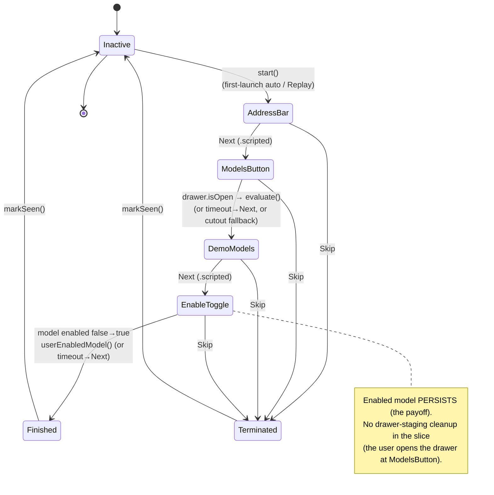
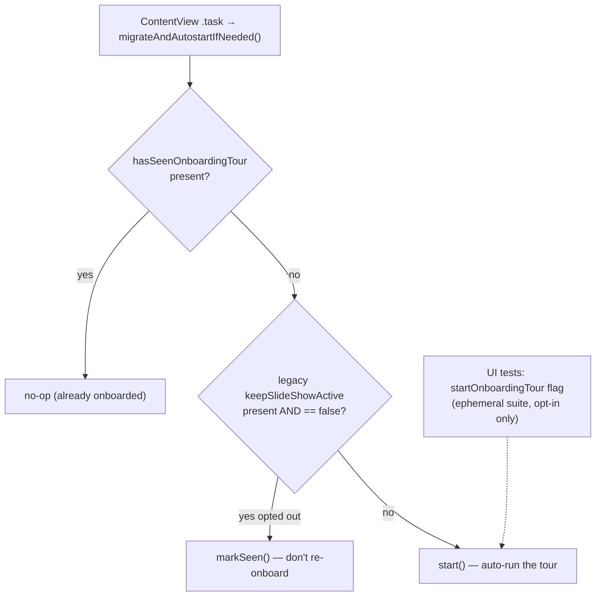
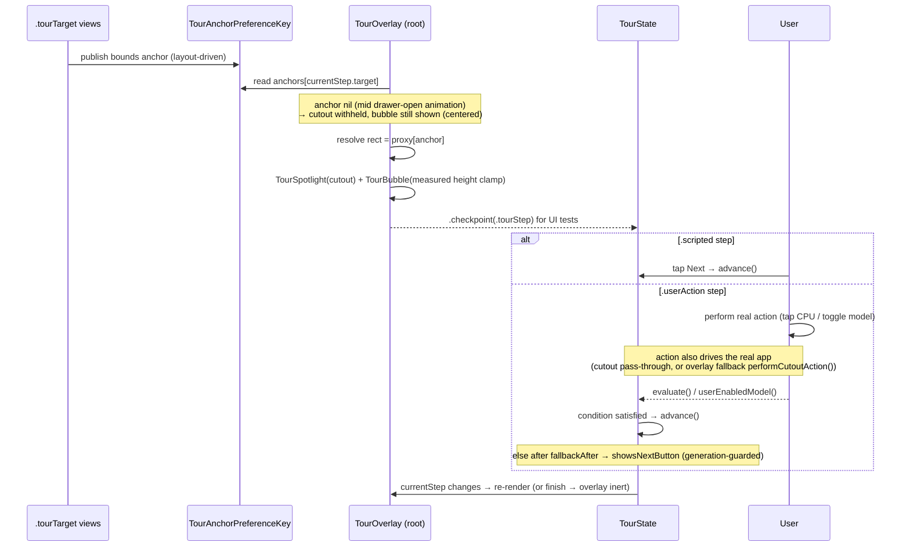

# Onboarding Tour — Architecture (AIA-0333)

Interactive coach-mark / spotlight onboarding: a full-screen dimming overlay with a cutout
around one target element plus a pointing bubble, driven by an `@Observable @MainActor` state
machine. All tour code lives in `ios/MLBrowser/iOS/UI/Tour/`; the only spray into existing views is
one `.tourOverlay(...)` at the root, `.tourTarget(...)` markers on targets, and three small hooks.

## 1. Component / ownership map

```mermaid
flowchart TB
    subgraph Persist["UserDefaults (gate)"]
        gate["hasSeenOnboardingTour<br/>(object(forKey:) != nil)"]
        legacy["keepSlideShowActive<br/>(legacy, migration only)"]
    end

    subgraph Engine["Tour/ module (encapsulated)"]
        TS["TourState<br/>@Observable @MainActor"]
        STEPS["TourStep.slice : [TourStep]<br/>addressBar → modelsButton →<br/>demoModels → enableModelToggle"]
        ADV["TourAdvance / AdvanceCondition<br/>.scripted | .userAction(.drawerOpened|.modelEnabled)"]
        OVL["TourOverlayModifier<br/>(.tourOverlay at root)"]
        SPOT["TourSpotlight<br/>dim + cutout"]
        BUB["TourBubble<br/>text + Next + Skip"]
        PK["TourAnchorPreferenceKey<br/>[TourAnchorID: Anchor&lt;CGRect&gt;]"]
        TGT[".tourTarget(_:) / .tourTargetIf(_:_:)"]
    end

    subgraph App["Existing app (integration points)"]
        AS["AppState @MainActor<br/>owns tour"]
        CV["ContentView"]
        DM["DrawerManager<br/>@Observable"]
        GT["GlobalToolbar<br/>CPU/models button"]
        WS["WebScreen<br/>address bar"]
        DC["DrawerContent<br/>demo models + enable toggle"]
        SV["SettingsView<br/>Replay onboarding"]
    end

    AS -->|owns| TS
    TS -->|holds| STEPS
    STEPS --- ADV
    TS -->|reads/writes| gate
    TS -->|one-shot migrate| legacy
    TS -. weak .-> DM

    CV -->|.tourOverlay tour| OVL
    OVL -->|reads anchors| PK
    OVL --> SPOT
    OVL --> BUB

    GT -->|.tourTarget .modelsButton| TGT
    WS -->|.tourTarget .addressBar| TGT
    DC -->|.tourTarget .demoModels / .enableModelToggle| TGT
    TGT -->|anchorPreference .bounds| PK

    CV -->|.task migrateAndAutostartIfNeeded| TS
    CV -->|onChange drawer.isOpen → evaluate| TS
    DC -->|toggle set → userEnabledModel| TS
    SV -->|Replay button → start| TS
    GT -->|tap opens drawer| DM
```

## 2. State machine (slice lifecycle)

`start()` does **not** flip the gate — only a terminal state (`finish`/`skip`) does, so an
interrupted/backgrounded tour re-arms. Every step also has **Skip**; `.userAction` steps surface a
**Next** fallback after `fallbackAfter` (default 8s, generation-guarded) so no step can deadlock.

## 3. Gate + autostart decision (first frame)

## 4. Render + advance data flow (per active step)

## Notes
- **Symbol-stripping safe:** steps match on the `TourAnchorID` enum, not stringly-typed names.
- **Coordinate space:** the overlay's `GeometryReader` resolves anchors with `.ignoresSafeArea()`,
  matching `TourSpotlight`'s full-screen draw — otherwise every cutout is offset by the top inset.
- **Dim taps never dismiss:** the dim has no tap gesture; only the explicit **Skip** button ends
  the tour. An interrupted tour re-arms (the gate flips only on a terminal state).
- **Bubble always renders:** the coach-mark (with Skip/Next) shows even before the target anchor
  resolves (centered), so a step can never be a dead-end blank dim.
- **Hit-test reality (measured, not assumed):** eoFill cutout pass-through does **not** deliver taps
  to controls beneath this overlay. So:
  - `.scripted` steps advance via the bubble's **Next**.
  - `.userAction(.drawerOpened)` is overlay-driven — a transparent tap target over the models-button
    cutout calls `performCutoutAction()` → opens the drawer (works because the drawer is closed).
  - `.userAction(.modelEnabled)` is **bubble-driven**: the toggle sits inside the open drawer beneath
    the dim where no tap reaches it, so the bubble's button enables a demo model (`enableModelHook`,
    registered by the drawer) and finishes. Its spotlight uses `spotlightFallback: .demoModels`
    because an anchor inside a `List` cell doesn't propagate to the overlay.
- **Slice scope:** address bar → models button → demo models → enable toggle. Remaining steps
  (settings/label-shape → play → find → finding form → save → list → share) are follow-ups.
