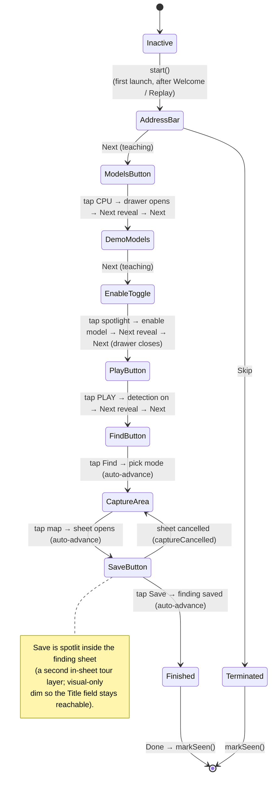
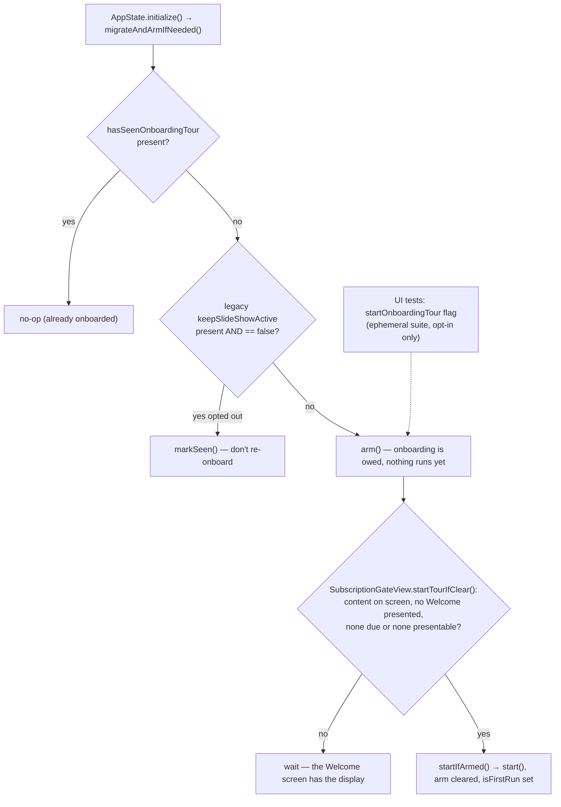
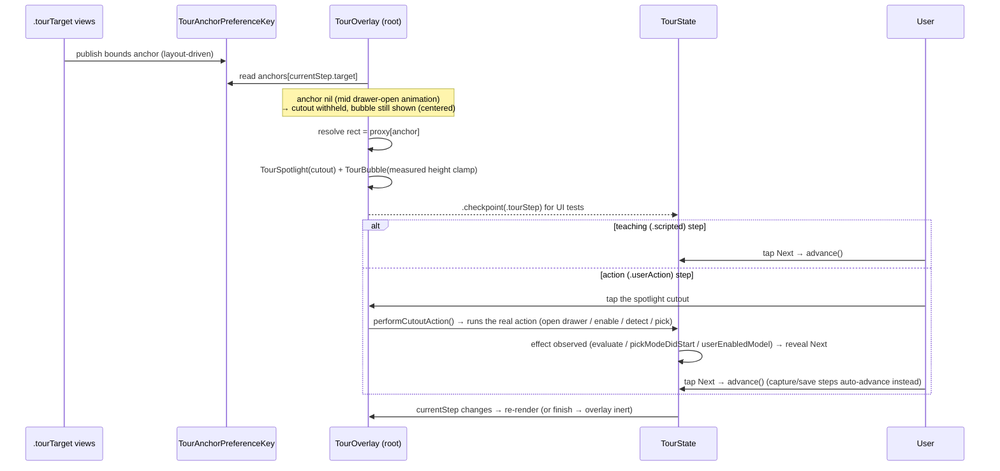

# Onboarding Tour — Architecture (AIA-0333)

Interactive coach-mark / spotlight onboarding: a dimming overlay (four rects around a cutout) plus
a pointing bubble, driven by an `@Observable @MainActor` state machine. All tour code lives in
`ios/MLBrowser/iOS/UI/Tour/`; the spray into existing views is `.tourOverlay(...)` at the root (and
once inside the finding sheet), `.tourTarget(...)` markers on targets, and a few small hooks. The
interaction model is real-action-gated — see §2 and `IMPLEMENTATION_PLAN_AIA-0333-rebuild.md`.

## 1. Component / ownership map

```mermaid
flowchart TB
    subgraph Persist["UserDefaults (gate)"]
        gate["hasSeenOnboardingTour<br/>(object(forKey:) != nil)"]
        legacy["keepSlideShowActive<br/>(legacy, migration only)"]
    end

    subgraph Engine["Tour/ module (encapsulated)"]
        TS["TourState<br/>@Observable @MainActor"]
        STEPS["TourStep.slice : [TourStep]<br/>addressBar → modelsButton → demoModels →<br/>enableModelToggle → playButton → findButton →<br/>captureArea → saveButton → finished"]
        ADV["TourAdvance / AdvanceCondition<br/>.scripted | .userAction(drawerOpened|modelEnabled|<br/>detectionStarted|pickModeEntered|captureStarted|findingSaved)"]
        OVL["TourOverlayModifier<br/>(.tourOverlay at root)"]
        SPOT["TourSpotlight<br/>dim + cutout"]
        BUB["TourBubble<br/>text + Next + Skip"]
        PK["TourAnchorPreferenceKey<br/>[TourAnchorID: Anchor&lt;CGRect&gt;]"]
        TGT[".tourTarget(_:)"]
    end

    subgraph App["Existing app (integration points)"]
        AS["AppState @MainActor<br/>owns tour"]
        SGV["SubscriptionGateView<br/>day-0 Welcome / paywall"]
        CV["ContentView"]
        DM["DrawerManager<br/>@Observable"]
        GT["GlobalToolbar<br/>CPU / PLAY / Find buttons"]
        WS["WebScreen<br/>address bar + map"]
        DC["DrawerContent<br/>demo models (drawer)"]
        SFS["SaveFindingSheet<br/>Save button (in-sheet tour layer)"]
        SV["SettingsView<br/>Replay onboarding"]
    end

    AS -->|owns| TS
    TS -->|holds| STEPS
    STEPS --- ADV
    TS -->|reads/writes| gate
    TS -->|one-shot migrate| legacy
    TS -. weak .-> DM
    TS -. weak .-> GD["Guide"]

    CV -->|.tourOverlay tour| OVL
    SFS -->|.tourOverlay tour, inSheet| OVL
    OVL -->|reads anchors| PK
    OVL --> SPOT
    OVL --> BUB

    GT -->|.tourTarget .modelsButton / .playButton / .findButton| TGT
    WS -->|.tourTarget .addressBar| TGT
    DC -->|.tourTarget .demoModels (whole drawer)| TGT
    SFS -->|.tourTarget .saveButton| TGT
    TGT -->|anchorPreference .bounds| PK

    AS -->|initialize → migrateAndArmIfNeeded (arms)| TS
    SGV -->|startTourIfClear → startIfArmed (starts)| TS
    CV -->|onChange drawer.isOpen / onReceive detection,findMode → evaluate/pickModeDidStart| TS
    DC -->|cutout tap → performCutoutAction (enable)| TS
    SFS -->|onAppear captureDidStart / save → findingDidSave| TS
    SV -->|Replay button → start| TS
```

## 2. State machine + the interaction model

`start()` does **not** flip the gate — only a terminal state (`finish`/`skip`) does, so an
interrupted/backgrounded tour re-arms. **Every step's bubble has a Next**, shown immediately for
teaching (`.scripted`) steps and **only once the user performs the step's action** for `.userAction`
steps; **Skip** is the only dismissal (there is no timeout fallback). Because a tap can't reach a
toolbar button or the drawer toggle *through* the overlay, action steps are **overlay-driven**:
tapping the spotlight runs the real action (`performCutoutAction`), whose effect reveals Next. The
two sheet-coupled steps (capture / save) **auto-advance** (the modal sheet covers the bubble).



`CaptureArea` is the one step that no longer matches production. Outside the tour, AIA-0868 turned
Find into an *alignment* mode: the page stays live under a large centre crosshair, and a finding is
taken by panning a detected rectangle beneath it and tapping the crosshair once it goes green.
`FindPickOverlay` therefore branches on `tour.isActive` and keeps the original full-screen one-tap
picker for the lesson, whose scripted map has no dependable detection to aim at. Teaching alignment
needs a fixture whose rectangles are deterministic; until then, do not "fix" that branch by deleting
it — the lesson's `tap map → sheet opens` transition is what it feeds.

## 3. Gate + arm/start decision (first launch)

Deciding that onboarding is owed and actually beginning it are two steps. `AppState.initialize()`
runs the migration and **arms** the tour; `SubscriptionGateView.startTourIfClear()` **starts** what
was armed, once nothing is owed the screen in front of it. The tour now runs *after* the day-0
Welcome screen (`AUTH-SUBSCRIPTION.md`), so a caller that both decided and began would start it
underneath one.

Arming stays in `initialize()`, before `isReady`, for two reasons. The gate's
`onChange(initial: true)` handlers are what start the tour and nothing re-fires them later, so arming
from a view would arm something nobody would ever act on. And `AnalyticsChoiceGate` holds the consent
question while `isPendingOrRunning` — armed **or** running, not just running — because on the launch
after a force-quit over the Welcome screen the tour is merely armed when that gate first computes,
and an `isActive` test would flash the consent screen full-width before the gate above had started
anything.



## 4. Render + advance data flow (per active step)



## Notes
- **Symbol-stripping safe:** steps match on the `TourAnchorID` enum, not stringly-typed names.
- **Coordinate space:** the overlay's `GeometryReader` resolves anchors with `.ignoresSafeArea()`,
  matching `TourSpotlight`'s full-screen draw — otherwise every cutout is offset by the top inset.
- **Dim taps never dismiss:** the dim has no tap gesture; only the explicit **Skip** button ends
  the tour. An interrupted tour re-arms (the gate flips only on a terminal state).
- **`start()`'s resets are live now:** closing the drawer and stopping detection used to be no-ops on
  a first launch, because the tour began from `AppState.initialize()` before `ContentView` existed.
  It begins after the Welcome screen instead, with `ContentView` mounted and bound — which is why the
  launch auto-detect is withheld while onboarding is owed, rather than starting behind a screen the
  user is still reading and being stopped again the moment they tap Continue.
- **A terminal state is also a funnel stage:** finish/skip emit `onboarding.tour_completed` /
  `tour_skipped`, but only for a run that began from an arm. Settings → Replay calls `start()`
  directly and is excluded, so the stage counts first runs — see `ANALYTICS.md`.
- **Bubble always renders:** the coach-mark (with Skip/Next) shows even before the target anchor
  resolves (centered), so a step can never be a dead-end blank dim.
- **Four-rectangle dim:** the dim is four rects around the cutout (no view over the hole) + a focus
  stroke; lighter in dark mode. A tap still can't reach a UIKit toolbar button / the drawer toggle
  *through* the overlay (measured; XCUITest can't either), so action steps are **overlay-driven**:
  - `.drawerOpened` / `.detectionStarted` / `.pickModeEntered` — a transparent tap target over the
    cutout calls `performCutoutAction()` to run the real action; its effect (observed by ContentView)
    reveals Next. `findModeRequested` is a transient pulse, so it's signalled via `pickModeDidStart()`
    rather than polled. The Find step auto-advances into the map step.
  - `.modelEnabled` — tapping the spotlit drawer enables a demo model (`enableModelHook`) and reveals
    Next; spotlight uses `spotlightFallback: .demoModels` (a List-cell anchor can't reach the overlay).
  - `.captureStarted` (no-dim map tap) and `.findingSaved` (real Save under the in-sheet step's
    **non-blocking** dim) reach the real control directly and **auto-advance**.
- **In-sheet step:** the Save sheet is modal above the root overlay, so it hosts its own
  `.tourOverlay(_, inSheet: true)`; the root skips `rendersInSheet` steps.
- **Full flow:** address bar → models button → demo models → enable model → PLAY → Find → tap map →
  save finding → done. Further steps (settings/label-shape, share, findings list) remain follow-ups.
